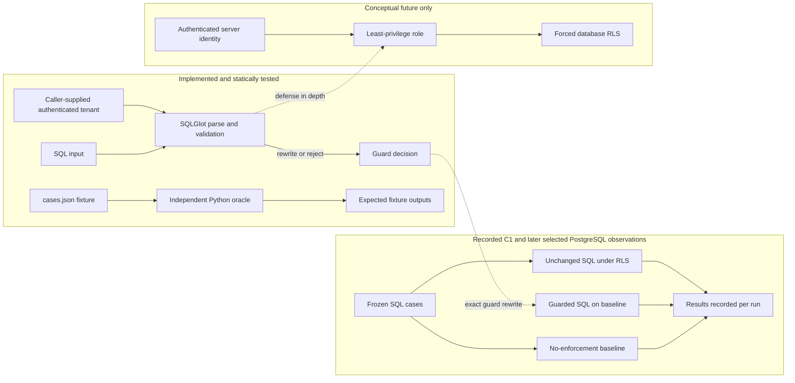

# Demo walkthrough: SQL tenant isolation

## Problem and threat model

Text-to-SQL can return valid SQL that omits a tenant filter. This project uses synthetic `tenant_a` and `tenant_b` customers and orders. It assumes the SQL is untrusted and the authenticated tenant argument is trusted server-side context; it does not implement authentication or prove that assumption. The protected boundary is row visibility for a restricted PostgreSQL principal.

The static Python guard parses a small PostgreSQL SQL subset with SQLGlot, validates statement/relation/function shapes, rejects unsupported queries, and injects the tenant predicate for supported physical fixture tables. A separate fixture oracle computes expected results directly from the frozen fixture rows. It does not call the guard or database policy.

## Architecture and trade-offs



AST rewriting can return an actionable rejection and can constrain supported query shapes before execution. It depends on correct parsing/scope resolution and on the application executing precisely the returned SQL. RLS filters rows within PostgreSQL even when a query omits a predicate, but relies on complete table policies and correct roles; superusers and `BYPASSRLS` roles bypass it, and table owners normally bypass unless RLS is forced. Each has setup and maintenance costs. This repository has no live execution wrapper and did not measure latency or operational performance.

## Frozen cases C1–C7

| Case | Intended construct | Current evidence |
|---|---|---|
| C1 | Direct selection missing tenant predicate | Original historical record contains its three PostgreSQL arms. |
| C2 | Join involving tenant-owned `orders` and `customers` | Executed once against PostgreSQL; results recorded separately. |
| C3 | CTE / nested scope | Executed once against PostgreSQL; baseline exposed tenant B, rewrite and RLS returned tenant A. |
| C4 | `SUM` aggregate where another tenant’s rows could affect the result | Executed once against PostgreSQL; results recorded separately; no cumulative disclosure evaluation. |
| C5 | Authorized positive control with explicit tenant predicate | Static coverage only; PostgreSQL untested. |
| C6 | Explicit request for conflicting tenant | Baseline returned `o_b1`; guard rejected it; RLS returned no rows. |
| C7 | A→B→A transaction/pool identity reuse intent | Static mapping mismatch only; no live connection pool or PostgreSQL lifecycle test. |

## C1 observation on record

Frozen SQL:

```sql
SELECT order_id FROM orders WHERE status = 'open' ORDER BY order_id;
```

The existing evidence record reports these tenant-A outcomes:

| Arm | Recorded rows |
|---|---|
| Baseline without tenant enforcement | `o_a1`, `o_a2`, `o_b1` |
| AST-rewritten query on baseline | `o_a1`, `o_a2` |
| Unchanged SQL under PostgreSQL RLS | `o_a1`, `o_a2` |

These outcomes are transcribed from [`results/c1_database_evidence.json`](results/c1_database_evidence.json). The record shows `sif_tenant_a` as both `current_user` and `session_user` for the relevant runs. That is the identity metadata captured then; it is not a current audit of every role attribute or policy. The original C1 SQL was not rerun during the later C2/C3/C4/C6 test runs. This is one historical synthetic C1 observation, not a general security guarantee or novelty claim.

## C2–C4 and C6 PostgreSQL observations

The opt-in read-only suite was run on 2026-10-27. Four case tests passed. Each arm ran as `sif_tenant_a`, with `session_user` also `sif_tenant_a`, inside a read-only transaction. The test observed a non-superuser, non-`BYPASSRLS`, non-owner role; baseline tables had RLS disabled, and both RLS tables had RLS enabled and forced.

| Case | No-enforcement baseline | AST rewrite on baseline | Unchanged SQL under RLS |
|---|---|---|---|
| C2 join | `o_a1/Ada`, `o_a2/Ari`, `o_b1/Bea` | `o_a1/Ada`, `o_a2/Ari` | `o_a1/Ada`, `o_a2/Ari` |
| C3 CTE | `o_a1`, `o_a2`, `o_b1` | `o_a1`, `o_a2` | `o_a1`, `o_a2` |
| C4 sum | `10500` | `1500` | `1500` |
| C6 conflicting tenant | `o_b1` | Guard rejected; no SQL executed | No rows |

The C2, C3, and C6 baselines exposed tenant-B data. The C4 unscoped total included tenant B’s `9000` contribution. Exact SQL, identities, metadata, observed rows, exit statuses, and expected outcomes are recorded in [`results/c2_c4_database_evidence.json`](results/c2_c4_database_evidence.json) and [`results/c3_c6_database_evidence.json`](results/c3_c6_database_evidence.json). These are single-case pilot observations. C5 and C7 remain untested against PostgreSQL.

## Run the safe static demo

From the project directory in Windows PowerShell, use Python 3.10+ and either `py` or a working `python` command. With the Windows Python Launcher:

```powershell
py -3 --version
py -3 -m venv .venv
$pilotPyExe = Join-Path (Get-Location) '.venv\Scripts\python.exe'
& $pilotPyExe -m pip install -r requirements.txt
& $pilotPyExe -m unittest discover -s tests -p test_sql_guard.py -v
```

If `py` is unavailable but `python` works, run `python --version` and `python -m venv .venv`, then run the remaining commands beginning with `$pilotPyExe` above. The package install is local to `.venv` and may require package-index access.

If `.vendor` is present and you want to avoid dependency installation, with a usable Python executable run:

```powershell
$env:PYTHONPATH = Join-Path (Get-Location) '.vendor'
py -3 -m unittest discover -s tests -p test_sql_guard.py -v
```

If `py` is unavailable, use `python -m unittest discover -s tests -p test_sql_guard.py -v` instead, or use the `.venv` executable after setting `PYTHONPATH`.

**Expected static result:** 12 tests pass. They cover parser/guard decisions, tested join and CTE scoping, rejection of selected unsupported/write/lock/schema shapes, fixture-oracle values, and static identity-map mismatch handling. They do not execute SQL against PostgreSQL. GitHub Actions runs this suite on Python 3.10 and 3.12.

## Optional read-only PostgreSQL checks for C2, C3, C4, and C6

If the two fixture databases and local password-file authentication are already configured, the opt-in suite compares the frozen join, CTE, and aggregate queries across the no-enforcement baseline, exact AST rewrite, and PostgreSQL RLS. For C6 it checks that the guard rejects a conflicting tenant request and that RLS returns no rows. It verifies database identity and selected role/table metadata. It runs only read-only queries and will not provision or alter the fixture. In PowerShell:

```powershell
$env:SIF_RUN_POSTGRES_TESTS = '1'
$env:SIF_PSQL = 'C:\Program Files\PostgreSQL\18\bin\psql.exe'
$env:SIF_PGHOST = '127.0.0.1'
$env:SIF_PGPORT = '5432'
& $pilotPyExe -m unittest discover -s tests -p test_postgres_readonly.py -v
```

The check uses the local PostgreSQL password file without prompting. The four PostgreSQL integration tests have passed for C2, C3, C4, and C6. GitHub Actions runs the 12 static tests only; it does not run these database-dependent tests.

## What remains untested

- C5 and C7 against PostgreSQL, including a real A→B→A connection-pool lifecycle.
- Live RLS configuration across every table, policy-removal detection, grants/role misconfiguration, authentication, connection pooling, rollback/reset, or concurrent tenant transitions.
- Arbitrary SQL/engine equivalence, hostile prompt/model output, data-agent tool authorization, resource limits, cumulative disclosure, or production operation.

See [`RESEARCH_BACKGROUND.md`](RESEARCH_BACKGROUND.md) for the papers that informed the problem framing and [`FUTURE_WORK.md`](FUTURE_WORK.md) for proposed directions, all clearly separated from current implementation.
