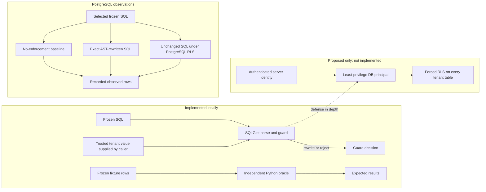

# SQL tenant-isolation portfolio demo

An engineering demo of tenant scoping for SQL that may be generated by an LLM. It compares a narrow SQLGlot AST rewrite with PostgreSQL row-level security (RLS) using synthetic two-tenant data. The project is a portfolio demo, not a general SQL firewall, production design, benchmark, novelty claim, or security guarantee.

## Problem and architecture

A valid query can omit a tenant predicate and return another tenant’s rows. This project tests two control points: an application-side parser/guard that rejects or rewrites a narrow SQL subset, and PostgreSQL RLS that filters rows for a restricted database principal. The tenant passed to the guard must come from trusted server authentication; the guard does not authenticate it.



The Python project has no application authentication or connection pool. Its opt-in read-only PostgreSQL checks have run for frozen C2 (join), C3 (CTE), C4 (aggregate), and C6 (conflicting tenant request) against the existing local fixture databases. The original C1 observation remains a separate historical record; all results are scoped to these specific cases and fixture configuration.

## Frozen workload coverage

| Case | Intended behavior | Evidence status |
|---|---|---|
| C1 | Direct selection missing tenant predicate | Three recorded PostgreSQL arms: baseline, guarded SQL, RLS. |
| C2 | Join between tenant-owned `orders` and `customers` | Read-only PostgreSQL comparison executed: baseline exposed tenant B; rewrite and RLS returned tenant-A rows. |
| C3 | CTE/nested scope | Read-only PostgreSQL comparison executed: baseline exposed tenant B; rewrite and RLS returned tenant-A rows. |
| C4 | `SUM` aggregate with possible cross-tenant contribution | Read-only PostgreSQL comparison executed: baseline total was 10500; rewrite and RLS returned 1500. No multi-query disclosure test. |
| C5 | Authorized positive control with a tenant predicate | Static coverage; no PostgreSQL validation. |
| C6 | Conflicting explicit tenant request | Baseline returned tenant B’s row; guard rejected the request; RLS returned no rows. |
| C7 | A→B→A identity/pool reuse intent | Static mapping check only; no real connection pool or PostgreSQL lifecycle test. |

The C1 record in [`results/c1_database_evidence.json`](results/c1_database_evidence.json) is historical and was not changed. Its statement that only C1 had been executed describes that record's time scope. `results/stage_a_preflight.json` is an older static snapshot that predates the database observations. Later C2/C4 and C3/C6 outcomes are recorded separately in [`results/c2_c4_database_evidence.json`](results/c2_c4_database_evidence.json) and [`results/c3_c6_database_evidence.json`](results/c3_c6_database_evidence.json). Baselines exposed tenant-B data for C2, C3, and C6. For C4, baseline returned `10500`; AST rewrite and RLS returned `1500`. For C2/C3, rewrite and RLS returned tenant-A rows; for C6, the guard rejected the conflicting request and RLS returned no rows. The tests confirmed `sif_tenant_a`, read-only transactions, and expected RLS flags. These observations do not establish a general security guarantee or validate C5 or C7.

The 12-test unit suite is static Python coverage for parsing, rewriting/rejection decisions, selected nested/write/join cases, fixture-oracle outputs, and static identity mapping. It does not execute SQL or validate RLS. The separate opt-in PostgreSQL suite has four passing case tests for C2, C3, C4, and C6; it runs only read-only queries against the existing databases. See [`DEMO_WALKTHROUGH.md`](DEMO_WALKTHROUGH.md) for commands and boundaries.

## Design trade-offs

| Control | Benefit | Failure modes and operational cost |
|---|---|---|
| AST validation/rewriting | Can reject unsupported SQL with a reason and add tenant predicates before execution; independent of a particular table policy once relations are understood. | Depends on parser/engine agreement, complete relation and scope resolution, and callers executing exactly the returned SQL. Rewriting can alter semantics; this pilot rejects several unsupported shapes. Requires maintaining and testing a strict SQL subset. No query-cost or timeout control is implemented. |
| PostgreSQL RLS | Enforces row predicates inside the database for queries executed by the restricted role, including SQL that omitted a predicate. | Protection depends on correct policies on every tenant table and correct runtime identity. Superusers and `BYPASSRLS` roles bypass RLS; owners normally bypass unless forced. Role/policy/grant migrations and pool identity require operational verification. The pilot has bounded observations for C1, C2, C3, C4, and C6, but no performance measurement or general security proof. |

These trade-offs describe expected mechanisms; the project has not measured comparative latency. A future design should use RLS as the primary row-access boundary and keep AST checks as defense in depth. See [`FUTURE_WORK.md`](FUTURE_WORK.md).

## Windows setup and static tests

Use Python 3.10+ and a project-local virtual environment. From the project directory in PowerShell, use either the Python Launcher or an installed `python` command:

```powershell
py -3 --version
py -3 -m venv .venv
$pilotPyExe = Join-Path (Get-Location) '.venv\Scripts\python.exe'
& $pilotPyExe -m pip install -r requirements.txt
& $pilotPyExe -m unittest discover -s tests -p test_sql_guard.py -v
```

If `py` is unavailable but `python` resolves to Python 3.10+, replace the first two commands with:

```powershell
python --version
python -m venv .venv
```

The remaining commands are unchanged. The dependency is installed inside `.venv`; no global install is required. Network access to the configured Python package index may be needed.

Optional offline path if `.vendor` is included in the checkout:

```powershell
$pilotPyExe = Join-Path (Get-Location) '.venv\Scripts\python.exe'
$env:PYTHONPATH = Join-Path (Get-Location) '.vendor'
& $pilotPyExe -m unittest discover -s tests -p test_sql_guard.py -v
```

`requirements.txt` pins SQLGlot 26.16.4. `.vendor` is a 4.32 MiB vendored copy that includes the dependency’s MIT license; retain that license if distributing it. It is included to support offline test runs. The project itself has no selected license.

## Optional read-only PostgreSQL checks (C2, C3, C4, and C6)

These checks require the already-provisioned `sql_isolation_pilot_fixture` and `sql_isolation_pilot_fixture_baseline` databases, the expected `sif_tenant_a` role, and valid local libpq password-file configuration. They do not create or alter database objects. `-w` prevents password prompts, and every query runs in a read-only transaction. From PowerShell:

```powershell
$env:SIF_RUN_POSTGRES_TESTS = '1'
$env:SIF_PSQL = 'C:\Program Files\PostgreSQL\18\bin\psql.exe'
$env:SIF_PGHOST = '127.0.0.1'
$env:SIF_PGPORT = '5432'
& $pilotPyExe -m unittest discover -s tests -p test_postgres_readonly.py -v
```

The test checks role/database identity, read-only transaction state, role restrictions, table ownership, and expected RLS flags. For C2, C3, and C4 it compares baseline SQL, the exact AST rewrite, and unchanged SQL under RLS. For C6 it records guard rejection without executing guarded SQL, then compares baseline with unchanged SQL under RLS. It is skipped unless explicitly enabled. GitHub Actions runs only the 12 static tests; it has no PostgreSQL credentials or service.

## Scope and records

The guard accepts one PostgreSQL-dialect `SELECT` over the unqualified fixture tables, with tested inner joins (`ON`/`USING`), nested SELECT/CTE scopes, simple predicates, ordering, and `SUM`. It rejects multiple statements, non-SELECT roots, nested writes, `SELECT INTO`, row locks, qualified fixture relations, unsupported relations/functions, and unsupported join shapes. It does not authenticate tenant identity, pin `search_path`, connect to a pool, enforce column-level access, limit cost, or provide a timeout.

- [`RESEARCH_BACKGROUND.md`](RESEARCH_BACKGROUND.md): two literature references and how they relate to this engineering demo.
- [`PROJECT_DECISION.md`](PROJECT_DECISION.md): portfolio-demo decision; no novelty claim.
- [`THREAT_MODEL.md`](THREAT_MODEL.md): assumptions and non-goals.
- [`IMPLEMENTATION_REPORT.md`](IMPLEMENTATION_REPORT.md) and [`FINAL_AUDIT.md`](FINAL_AUDIT.md): implementation and audit snapshots.
- [`COMPETITOR_REVIEW.md`](COMPETITOR_REVIEW.md): documented competitor/source review and addendum.
- [`FUTURE_WORK.md`](FUTURE_WORK.md): proposals only, not implemented architecture.

`results/stage_a_preflight.json` is an older static snapshot that predates all recorded PostgreSQL observations. The optional `pilot.py` runner writes JSON and defaults to that historical path; provide a fresh output path if running it.

- [`POST_PUBLICATION_CHECKLIST.md`](POST_PUBLICATION_CHECKLIST.md): current public-repository and evidence status.
